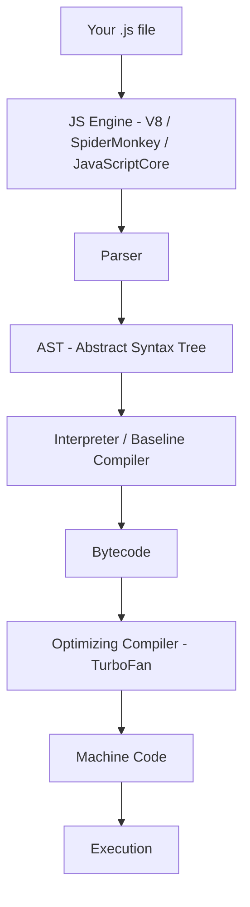
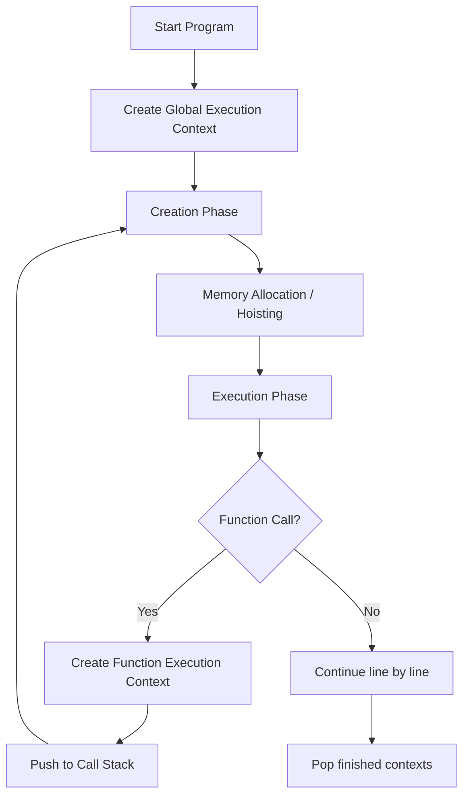
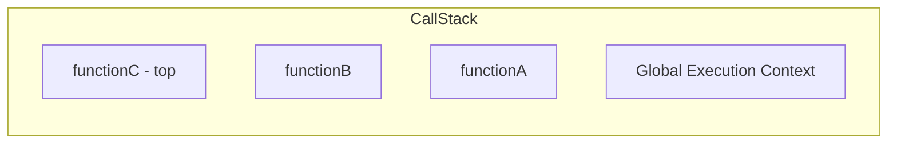
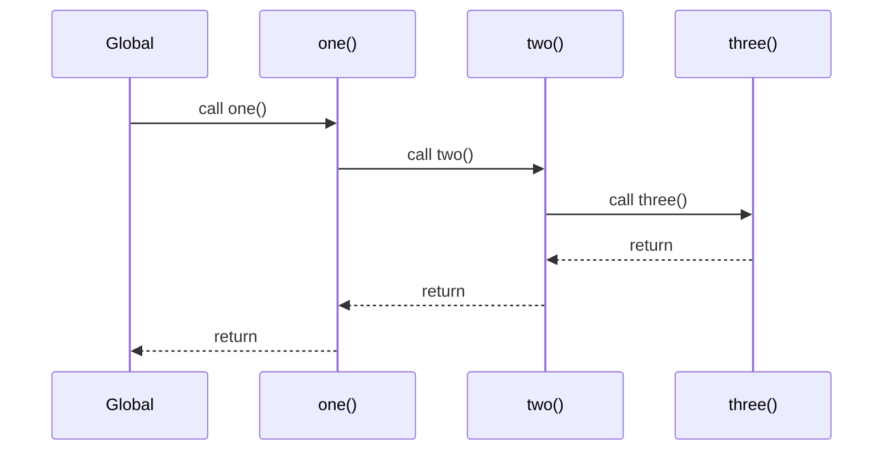
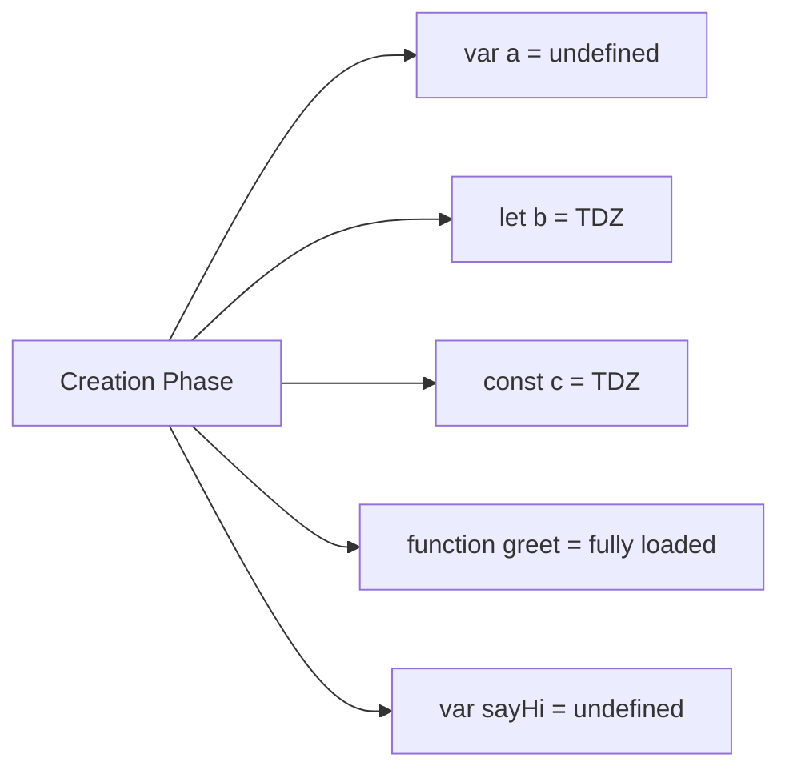
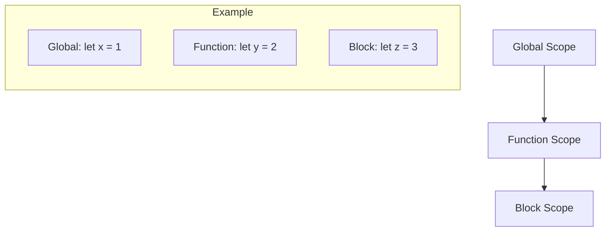
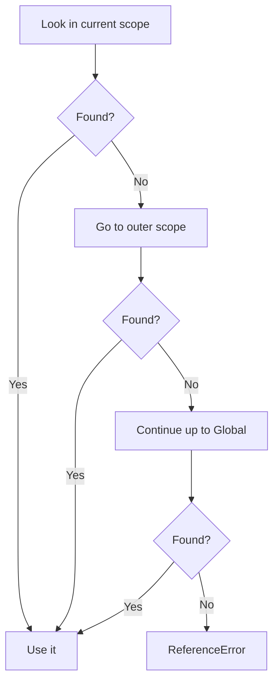
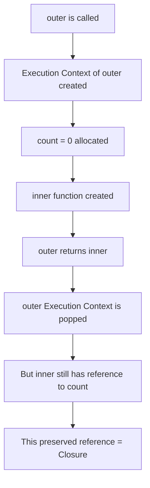
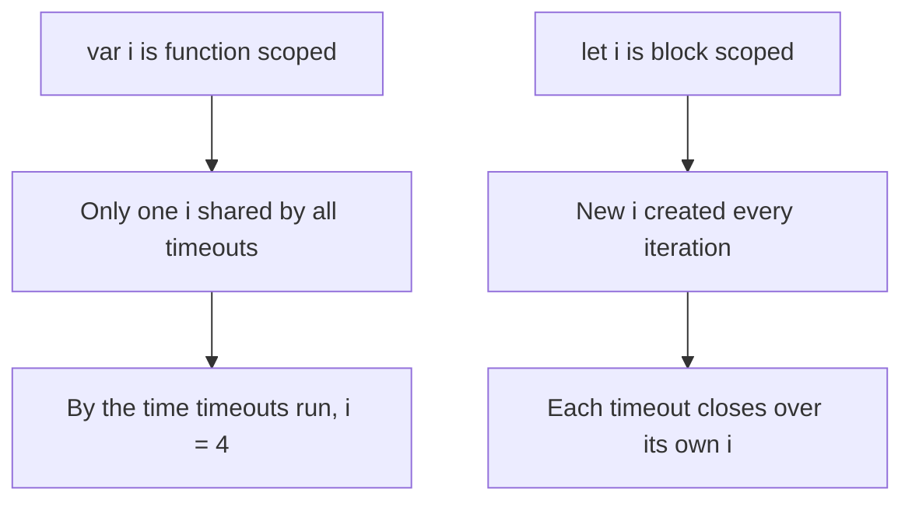
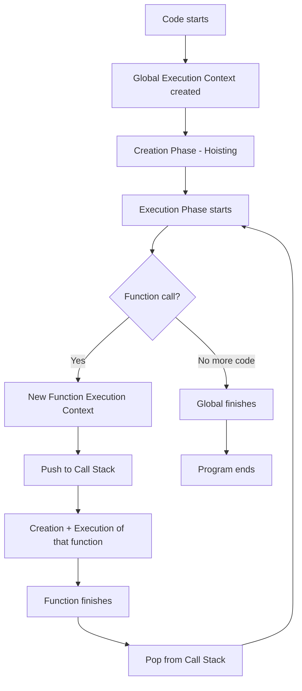

# Phase 3 — The HOW Begins (Behind The Scenes of JavaScript)

**Goal:** Understand exactly what happens when JavaScript runs your code.  
This is the phase that separates people who *use* JavaScript from people who *understand* it.

**Interview Weight:** Extremely High

---

## 1. How JavaScript Actually Runs



- JavaScript is **single-threaded** → only one call stack
- It looks synchronous, but uses the **Event Loop** for async work
- Modern engines use **JIT (Just-In-Time)** compilation

---

## 2. Execution Context (The Most Important Concept)

Every time the engine runs code, it creates an **Execution Context**.



### Two Phases of Every Execution Context

| Phase | What happens |
|-------|--------------|
| **Creation Phase** | Memory is allocated. Variables are hoisted. `var` → `undefined`, functions are fully hoisted, `let`/`const` stay in TDZ |
| **Execution Phase** | Code runs line by line. Values are assigned. Functions are called. |

### Types of Execution Context

1. **Global Execution Context (GEC)** — created once when the program starts
2. **Function Execution Context (FEC)** — created every time a function is called
3. **Eval Execution Context** — rare (from `eval()`)

---

## 3. Call Stack (How JS Tracks Function Calls)



**Rules:**
- LIFO → Last In, First Out
- Only one function runs at a time
- When a function finishes → it is popped
- Stack overflow = too many nested calls (usually infinite recursion)

### Visual Example

```js
function one() {
  console.log("one");
  two();
}

function two() {
  console.log("two");
  three();
}

function three() {
  console.log("three");
}

one();
```



---

## 4. Hoisting (What Really Happens in Creation Phase)

```js
console.log(a);  // undefined
console.log(b);  // ReferenceError
console.log(c);  // ReferenceError

var a = 10;
let b = 20;
const c = 30;

greet();         // works
// sayHi();      // TypeError

function greet() {
  console.log("Hello");
}

var sayHi = function() {
  console.log("Hi");
};
```



---

## 5. Scope & Scope Chain



When JavaScript looks for a variable:



This is called the **Scope Chain**.

---

## 6. Closures (Deep Visualization)

**Definition:**  
A closure is when an inner function remembers the variables of its outer function **even after the outer function has finished executing**.

```js
function outer() {
  let count = 0;                    // this variable lives in outer's scope

  function inner() {
    count++;                        // inner closes over count
    return count;
  }

  return inner;
}

const counter = outer();            // outer() finishes, but count is still alive
console.log(counter());             // 1
console.log(counter());             // 2
```



### Classic Closure + Loop Problem

```js
// Broken version
for (var i = 1; i <= 3; i++) {
  setTimeout(() => console.log(i), 1000);
}
// 4 4 4

// Fixed with let
for (let i = 1; i <= 3; i++) {
  setTimeout(() => console.log(i), 1000);
}
// 1 2 3
```



---

## 7. Full Mental Model (Put It All Together)



---

## Interview Questions (Must Master)

1. What is an Execution Context? Explain the two phases.
2. What is the Call Stack? How does it work?
3. What is Hoisting? Difference between `var`, `let`, `const`.
4. What is Temporal Dead Zone?
5. What is lexical scope?
6. What is a closure? Give real definition + example.
7. Explain the classic `for` loop + `setTimeout` problem.
8. How would you create private variables in JavaScript?
9. What causes Stack Overflow?
10. Draw the scope chain for a nested function.

---

## Practice

```js
// Predict + explain every step
var x = 10;

function outer() {
  var y = 20;

  function inner() {
    var z = 30;
    console.log(x, y, z);
  }

  return inner;
}

const fn = outer();
fn();
```
