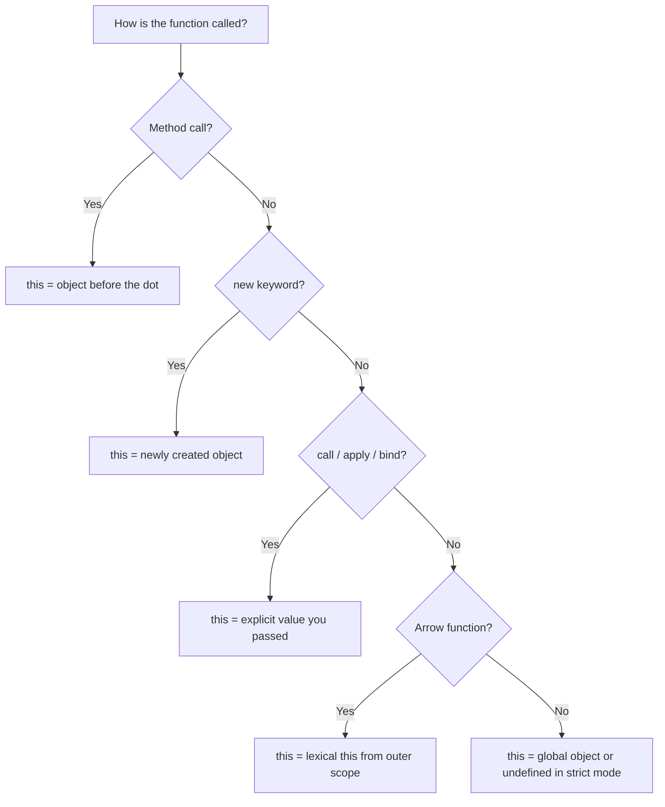
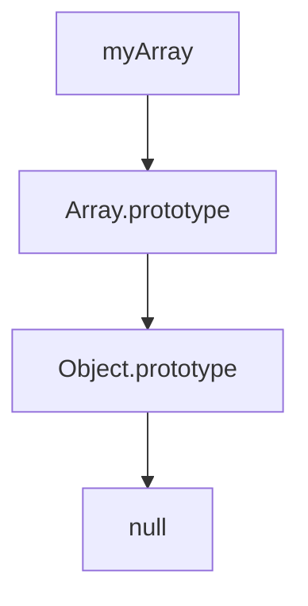
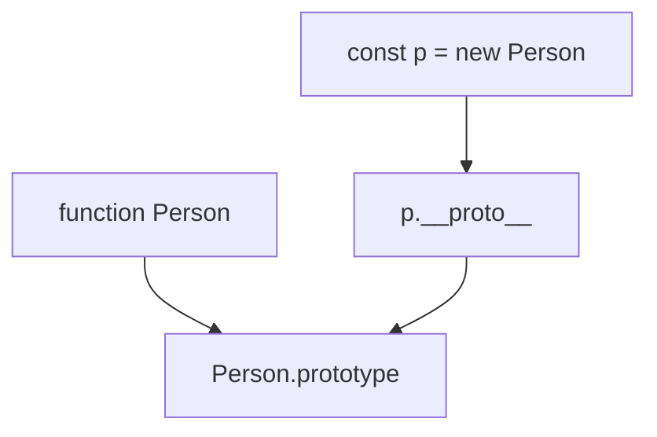
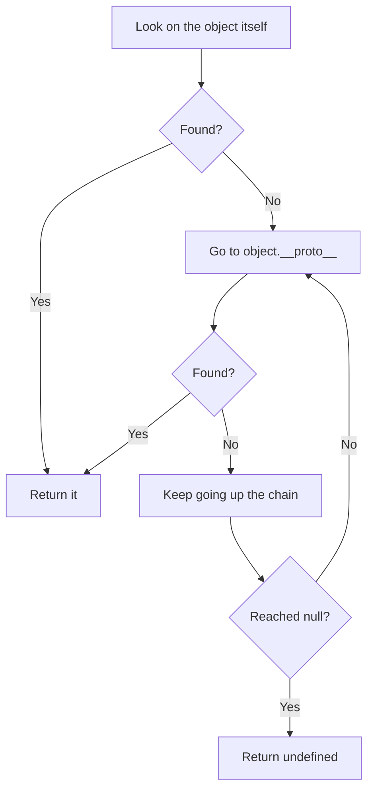
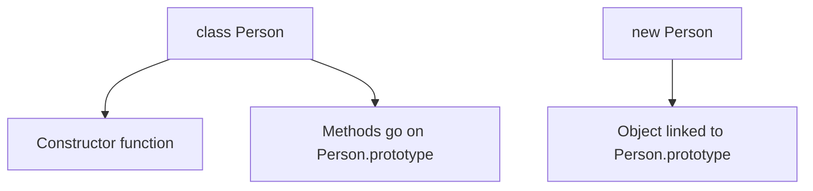
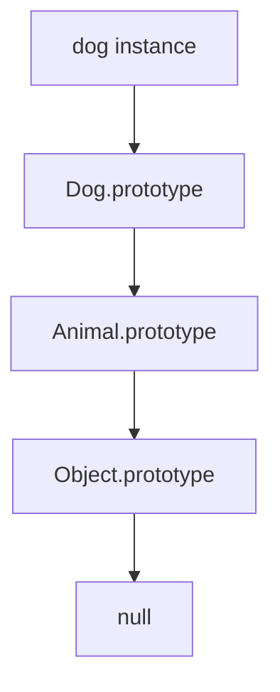

# Phase 4 — Objects Deeper & `this` (Full Visualization)

**Goal:** Understand how JavaScript’s object model actually works and why `this` confuses everyone.

**Interview Weight:** Very High

---

## 1. The `this` Keyword — Binding Rules

`this` is **not** determined by where the function is written.  
It is determined by **how the function is called**.



### Examples

```js
// 1. Method call
const user = {
  name: "Alex",
  greet() {
    console.log(this.name);   // "Alex"
  }
};
user.greet();

// 2. Regular function
function show() {
  console.log(this);          // window (browser) or global (Node)
}
show();

// 3. Arrow function (lexical)
const obj = {
  name: "Sam",
  greet: () => {
    console.log(this.name);   // undefined (arrow takes outer this)
  }
};

// 4. Explicit binding
function introduce(city) {
  console.log(`${this.name} from ${city}`);
}
introduce.call({ name: "Riya" }, "Delhi");
introduce.apply({ name: "Riya" }, ["Delhi"]);
const bound = introduce.bind({ name: "Riya" });
bound("Delhi");
```

---

## 2. Prototypes (The Real Inheritance Model)

Every object in JavaScript has an internal link to another object called its **prototype**.



```js
const arr = [1, 2, 3];

console.log(arr.__proto__ === Array.prototype);           // true
console.log(Array.prototype.__proto__ === Object.prototype); // true
console.log(Object.prototype.__proto__);                  // null
```

### `__proto__` vs `prototype`

| | Meaning |
|--|--------|
| `obj.__proto__` | The actual prototype link of that object (legacy getter) |
| `Func.prototype` | The object that will be used as `__proto__` for instances created by `new Func()` |



---

## 3. Prototype Chain Lookup

When you access a property:



---

## 4. ES6 Classes are Syntactic Sugar

```js
class Person {
  constructor(name) {
    this.name = name;
  }
  greet() {
    console.log(`Hi, ${this.name}`);
  }
}
```

What it actually becomes:

```js
function Person(name) {
  this.name = name;
}

Person.prototype.greet = function() {
  console.log(`Hi, ${this.name}`);
};
```



---

## 5. Inheritance with `extends`

```js
class Animal {
  constructor(name) {
    this.name = name;
  }
  speak() {
    console.log(`${this.name} makes a sound`);
  }
}

class Dog extends Animal {
  speak() {
    console.log(`${this.name} barks`);
  }
}
```



---

## 6. Interview Questions

1. How is `this` determined?
2. Difference between regular function and arrow function regarding `this`.
3. What do `call`, `apply`, and `bind` do? Differences?
4. What is a prototype?
5. Difference between `__proto__` and `prototype`?
6. Explain the prototype chain.
7. Are classes syntactic sugar? Prove it.
8. How does `new` work under the hood?
9. What is the value of `this` in global scope (browser vs Node)?
10. How would you create inheritance without `class`?

---

## Practice

```js
const obj = {
  name: "Test",
  regular: function() {
    console.log("regular:", this.name);
  },
  arrow: () => {
    console.log("arrow:", this.name);
  }
};

obj.regular();
obj.arrow();

const fn = obj.regular;
fn();               // what is this?
```
