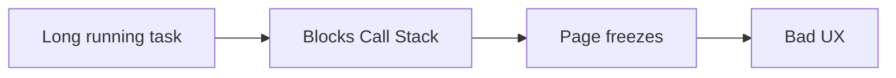
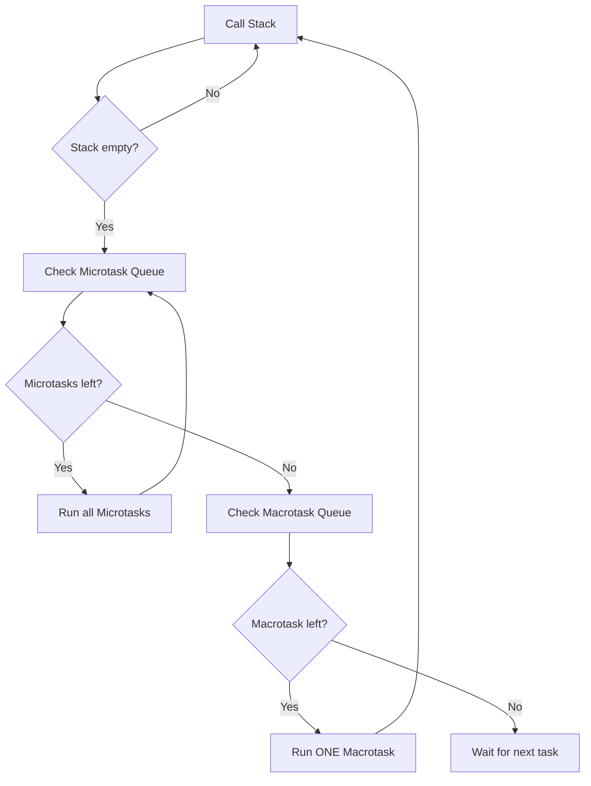
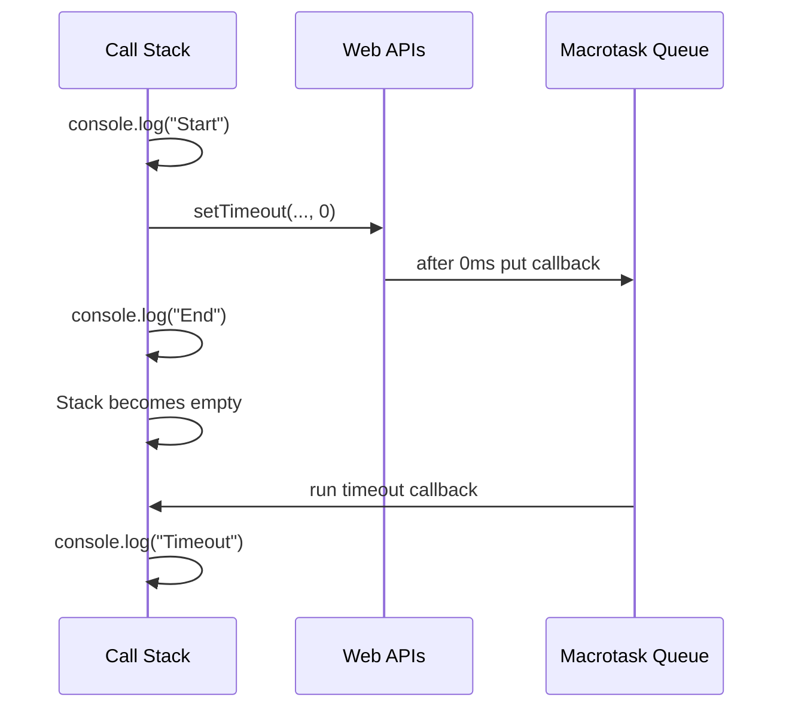
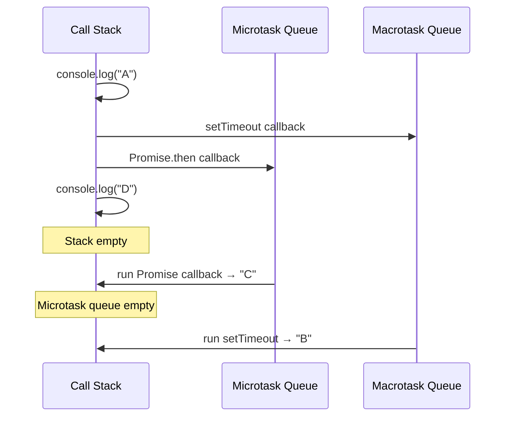
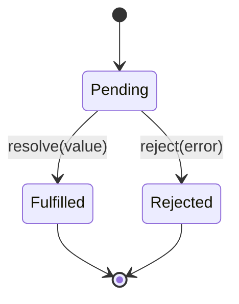
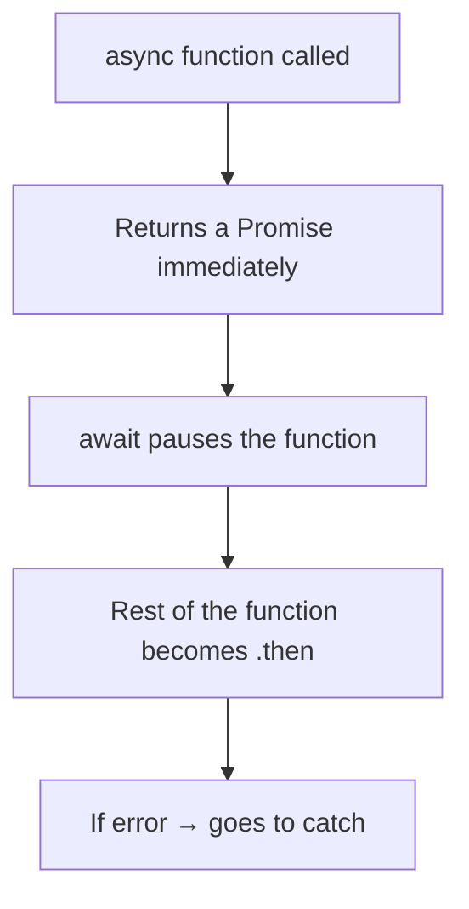
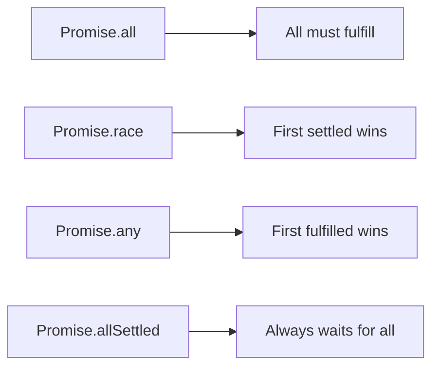
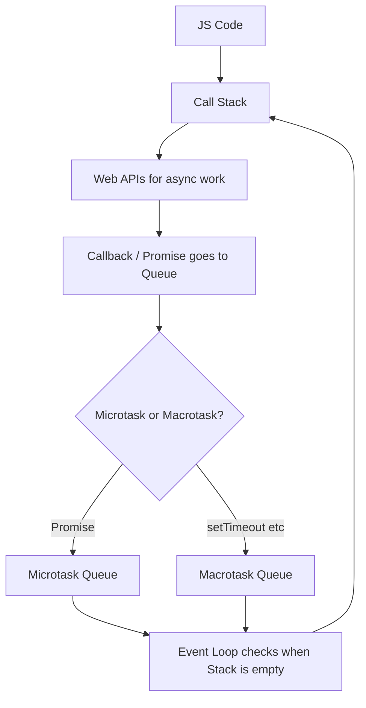

# Phase 5 — Asynchronous JavaScript (Full Visualization)

**Goal:** Master async code. Understand the Event Loop completely.  
Stop being afraid of `async`/`await`.

**Interview Weight:** Extremely High

---

## 1. Why Async Exists

JavaScript has **one call stack**. If a long task (network, timer, file) blocked it, the browser would freeze.



Solution → Hand the long task to the browser/Web API and continue.

---

## 2. The Big Picture — How Async Really Works



### Components

| Component | What it holds | Examples |
|-----------|---------------|----------|
| **Call Stack** | Currently running code | Functions, global code |
| **Web APIs** | Browser features | `setTimeout`, `fetch`, DOM events |
| **Microtask Queue** | High priority async | Promises, `queueMicrotask`, `MutationObserver` |
| **Macrotask Queue** | Lower priority async | `setTimeout`, `setInterval`, I/O, UI rendering |

**Golden Rule:**  
After every task, the engine empties the **entire Microtask queue** before taking the next Macrotask.

---

## 3. setTimeout is NOT a precise timer

```js
console.log("Start");

setTimeout(() => {
  console.log("Timeout");
}, 0);

console.log("End");
```



Output:
```
Start
End
Timeout
```

---

## 4. Promises & Microtasks

```js
console.log("A");

setTimeout(() => console.log("B"), 0);

Promise.resolve().then(() => console.log("C"));

console.log("D");
```



**Output: A D C B**

---

## 5. Promise Lifecycle



```js
const p = new Promise((resolve, reject) => {
  // executor runs immediately
  resolve("Success");
});

p.then(result => console.log(result))
 .catch(err => console.error(err))
 .finally(() => console.log("Done"));
```

---

## 6. async / await (Under the Hood)

`async/await` is **syntactic sugar** over Promises.

```js
async function load() {
  try {
    const res = await fetch("/api/data");
    const data = await res.json();
    return data;
  } catch (err) {
    console.error(err);
  }
}
```

What actually happens:



---

## 7. Promise Combinators

```js
// Runs in parallel, fails fast
Promise.all([p1, p2, p3]);

// Waits for all, never rejects
Promise.allSettled([p1, p2, p3]);

// First one to settle (resolve or reject)
Promise.race([p1, p2, p3]);

// First one to resolve (ignores rejects until all reject)
Promise.any([p1, p2, p3]);
```



---

## 8. Classic Event Loop Output Questions

### Question 1
```js
console.log(1);

setTimeout(() => console.log(2), 0);

Promise.resolve().then(() => console.log(3));

console.log(4);
```
**Answer:** 1 4 3 2

### Question 2
```js
async function foo() {
  console.log(1);
  await Promise.resolve();
  console.log(2);
}

console.log(3);
foo();
console.log(4);
```
**Answer:** 3 1 4 2

### Question 3
```js
setTimeout(() => console.log("A"), 0);

Promise.resolve()
  .then(() => {
    console.log("B");
    return Promise.resolve("C");
  })
  .then(console.log);

console.log("D");
```
**Answer:** D B C A

---

## 9. Fetch + JSON

```js
async function getUser(id) {
  try {
    const res = await fetch(`https://api.example.com/users/${id}`);
    if (!res.ok) throw new Error("Network response was not ok");
    const data = await res.json();
    return data;
  } catch (err) {
    console.error("Failed:", err.message);
  }
}
```

---

## 10. Interview Questions You Must Own

1. Explain the Event Loop with a diagram.
2. Difference between Microtask queue and Macrotask queue.
3. What is the output of mixed `setTimeout` + Promise questions?
4. States of a Promise.
5. `Promise.all` vs `Promise.allSettled` vs `Promise.race` vs `Promise.any`.
6. What happens if you forget `await`?
7. How does `async/await` work under the hood?
8. How would you run async tasks in parallel?
9. How would you run them sequentially?
10. Write a retry function for a failed fetch.

---

## Mental Model Summary


